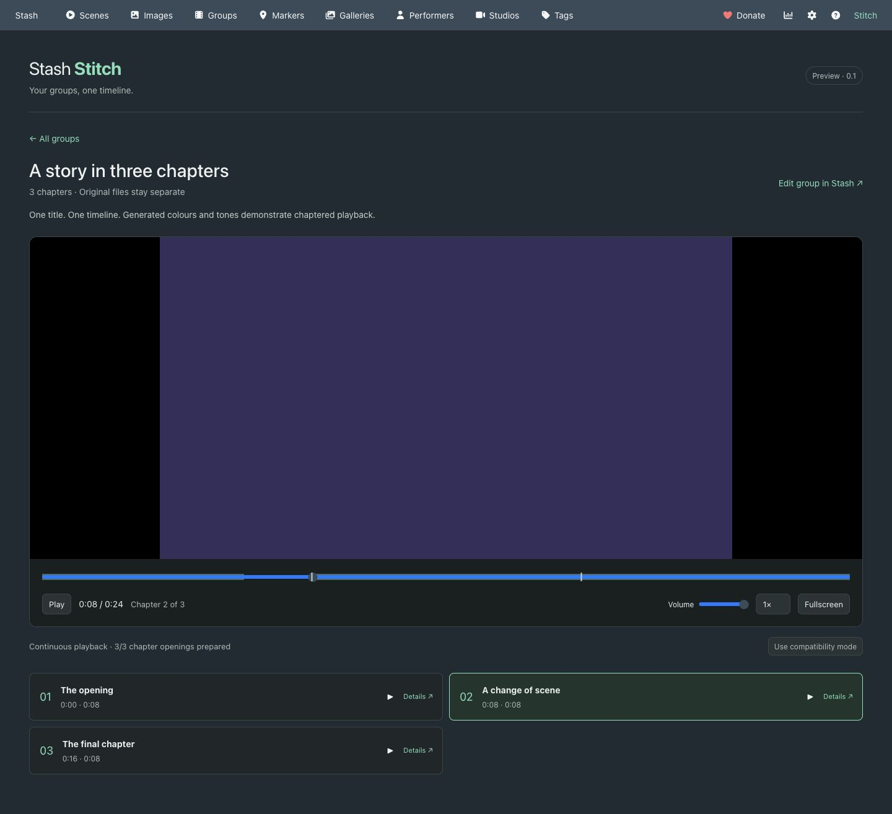

# Stash Stitch

**Turn scene groups into one chaptered viewing experience.**

Stash Stitch is a browser-only UI plugin for [Stash](https://github.com/stashapp/stash). A group becomes one playable item with its own title, synopsis and cover. Its scenes sit on a combined timeline: seek halfway through the group and Stitch finds the corresponding scene and position.

**Early preview.** Compatible MP4s can play through a single media element. Mixed formats have a compatibility mode with best-effort transitions. No separate helper, permanent file merge, or media upload is required.



## Features

- Group library with one card per group, title, synopsis and cover.
- Group cards in Stash open the Stitch player; the original group remains available through **Edit group in Stash**.
- Chapters follow Stash's scene index, with scene ID as a deterministic fallback.
- One seek bar, total duration, chapter buttons, volume, speed and fullscreen controls.
- Continuous mode repackages MP4 samples in browser memory and preloads roughly the first five seconds of each chapter (rounded to keyframe boundaries, subject to memory limits).
- Playback and seeking take priority over speculative preloading; about 25 seconds of the current playback path are prepared ahead.
- Compatibility mode keeps the next scene in a second media element to reduce transition delays.
- Resume position is saved locally in that browser.
- Ungrouped scenes are available in a separate library tab.

## Install

Requires **Stash v0.32.0** (the version used for integration testing). Other versions are unverified.

1. Download `stash-stitch.zip` from [Releases](https://github.com/mjvanraaphorst/stash-stitch/releases).
2. Extract it into your Stash plugins directory so the layout is:

   ```text
   <plugins directory>/stash-stitch/
     stash-stitch.yml
     stash-stitch.js
     stash-stitch.css
   ```

3. In Stash, open **Settings → Plugins**, reload plugins, then refresh the browser page. Restarting Stash also reloads the manifest.
4. Click **Stitch** in the navigation, or open `/plugins/stash-stitch` on your Stash server.
5. Open a group, choose **Prepare playback**, then **Play**. If continuous mode reports incompatible media, choose **Use compatibility mode**.

Alternatively, add the following source URL in **Settings → Plugins → Available Plugins → Add source**, then install **Stash Stitch**:

```text
https://raw.githubusercontent.com/mjvanraaphorst/stash-stitch/main/index.yml
```

The plugin's runtime files are also committed in `plugin/`, so installation does not require Node or a build tool. To uninstall, remove Stash Stitch through the plugin manager (if installed there), or remove its directory and reload plugins. Scene files and group metadata are untouched.

## Browser and media compatibility

| Path | Chrome on macOS | Safari on macOS |
| --- | --- | --- |
| Continuous MP4 playback | Chromium automated tests + Chrome integration checks | WebKit automated tests + Safari integration checks |
| Combined seeking and chapters | Tested | WebKit tested |
| Mixed-format compatibility mode | Tested with native MP4 | WebKit tested with native MP4 |

Continuous mode currently requires ordinary, non-fragmented MP4 files served with HTTP byte ranges, one video track and at most one audio track. Chapter track IDs, codec strings, resolution and audio configuration must match. Each browser must support the codecs through Media Source Extensions. H.264 video and AAC audio are the initial test baseline.

MP4s with metadata at the end are supported. Complex edit lists, fragmented MP4 inputs, multiple audio tracks and unsupported containers are rejected with a visible fallback option. This version does not re-encode media. Some files can play in Stash's normal player but cannot use Stitch continuous mode.

Compatibility mode can use streams playable natively by the browser, including Stash's existing server streaming options. Stash itself may transcode those options as it normally does. Stitch runs no external service. Preloading is browser-controlled in compatibility mode and cannot promise an exact five-second buffer.

**Gapless audio and video across arbitrary files are not guaranteed.** Timing, encoder padding, differing media configurations, bandwidth and browser memory management affect transitions. Mobile Safari, AirPlay, casting, VR playback, subtitles, funscripts and Stash play-history updates are not supported by this preview. Use the original scene player for those features. Fullscreen keeps the combined controls where the browser supports element fullscreen.

Stitch provides its own grouped library; it does **not** collapse the stock Scenes grid or alter its pagination and filters. Groups and ungrouped scenes currently use separate tabs. Groups include direct scene members only, not recursive subgroups.

## Privacy and resource use

All metadata requests and media reads stay on the current Stash origin, using your existing signed-in session. There is no telemetry, third-party CDN or external API. No API key is required by the plugin. Resume time is stored in this browser's local storage, keyed by group ID; it is not written back to Stash.

Requests use bounded byte ranges. Speculative chapter prebuffering has a 64 MB accounting budget; playback retains a rolling window and evicts old data. These are application-level controls, not a hard cap on total browser memory. A single media segment and metadata read each have a 64 MB safety limit. Very large groups may prepare only some chapter openings, and browsers may evict buffered data themselves.

## Development

Use Node 22 or newer.

```sh
npm ci
npm run build
npm test
```

Browser tests use generated colour clips and tones, never personal media:

```sh
# If your npm configuration blocks package install scripts:
node node_modules/ffmpeg-static/install.js
npx playwright install chromium webkit
node scripts/fixtures.mjs
npm run test:browser
```

For a synthetic interactive demo, run `node scripts/test-server.mjs` and visit `http://127.0.0.1:4177/plugins/stash-stitch`. This server is test tooling; users do not run it to use the plugin.

`scripts/seed-stash.mjs` populates a separate, manually started Stash test instance at **127.0.0.1:4178 only**. It creates synthetic scenes and groups and must not be pointed at a personal library. Download the official Stash binary yourself and configure its library path to `.local/media` and plugins path to `plugin/` if reproducing that integration test.

See [validation notes](docs/VALIDATION.md) and [architecture](docs/ARCHITECTURE.md). Reports with Stash version, browser/OS version, container, codec and sanitized error text are welcome. Do not attach personal media, API keys or authenticated stream URLs to public issues.

## License

MIT. MP4 parsing and in-memory fragmentation use [MP4Box.js](https://github.com/gpac/mp4box.js) under its BSD-3-Clause license; its notice ships with the plugin.
